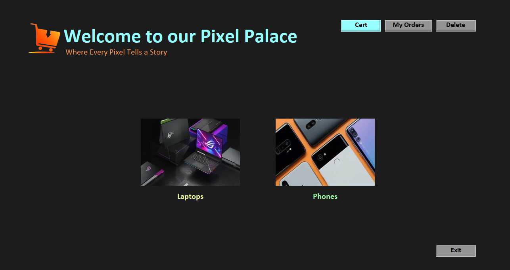
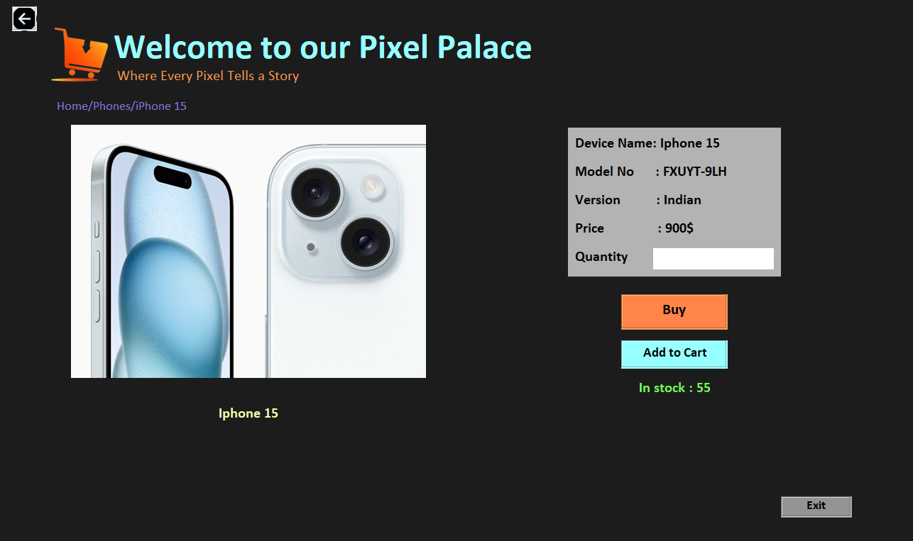
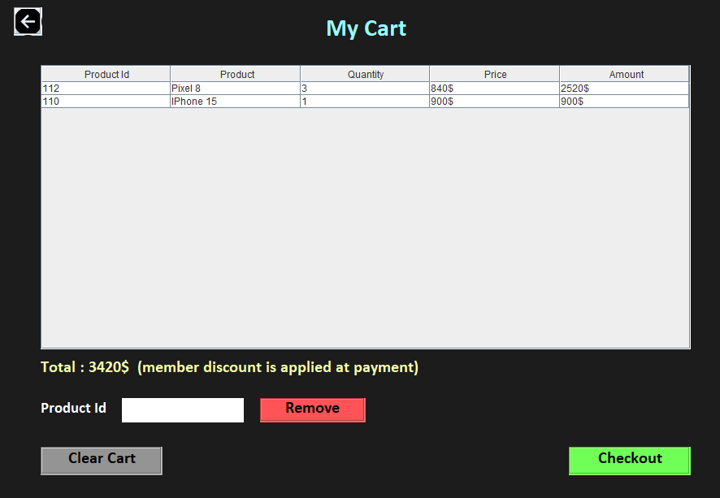
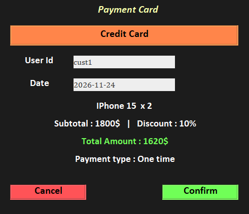
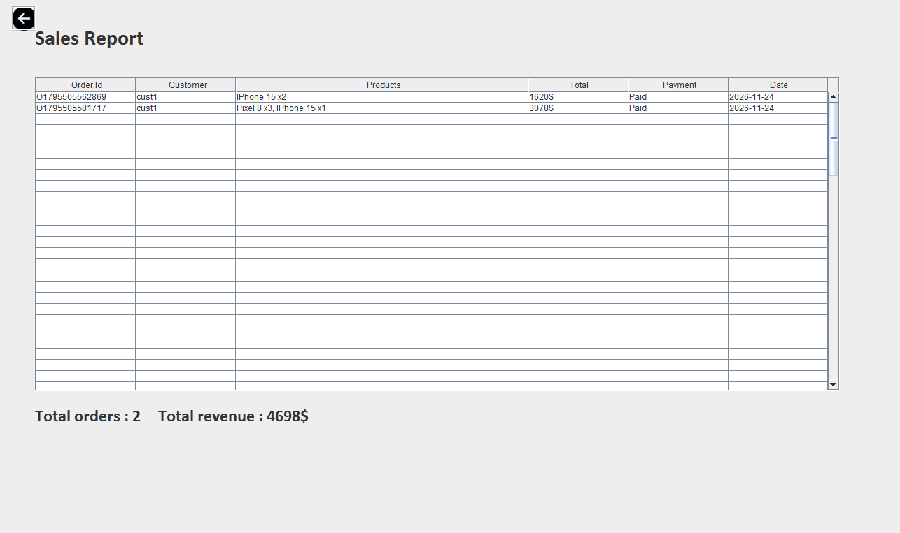
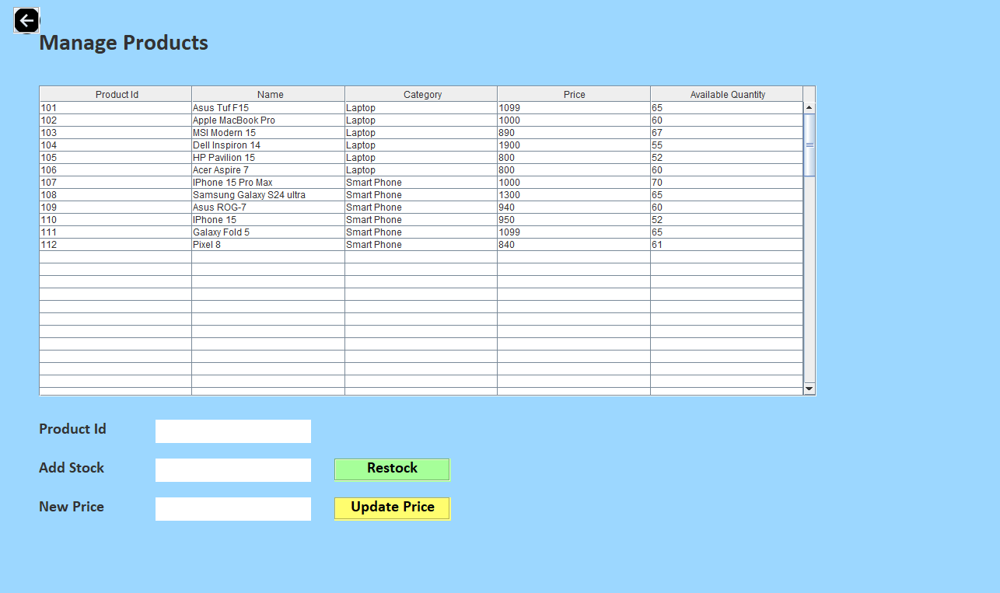

# Pixel Palace – Shop Management System

A desktop shop management system for an electronics store that sells laptops and smartphones, built with **Java Swing**. Customers can browse products and buy them. Owners can manage customers, owners and employees.

I built this as my 2nd-semester Object-Oriented Programming (OOP) course project at AIUB.



## Live demo

**Try it in your browser:** https://durjoysaha21.github.io/Shop-Management-Project/

The original Java Swing app runs in the browser through [CheerpJ](https://cheerpj.com/), with no install. The first load takes 10–20 seconds. Your accounts and orders are saved only in your own browser.

## Features

**Customer**
- Sign up, log in and reset a forgotten password with a security question
- Browse laptops (Asus, Apple, MSI, Dell, HP, Acer) and phones (iPhone, Samsung, Asus ROG, Google Pixel), with live price and stock on every product page
- Buy a product straight away, or add several products to the **Cart** and check out once
- Membership discount (Silver 10%, Gold 20%, Platinum 30%) is taken off at payment
- Quantities are checked against the stock, and the stock is reduced after payment; out-of-stock products can't be bought
- See past orders on the **My Orders** screen
- Delete their own account after confirming the password

**Owner**
- Add, remove, search and update customers, owners and employees
- View the customer list, owner list and product list with stock levels
- **Sales Report**: every order with its products, plus total orders and total revenue
- **Manage Stock**: restock products and change prices

**Employee**
- Log in to the restock screen and add stock to products

## Tech and concepts

- Java, Swing (GUI)
- OOP: classes, inheritance (`User` → `Customer`, `Owner`, `Employer`) and interfaces
- Repository pattern: each entity has an interface (`interfaces/`) and a repository class (`repositories/`) that handles saving and loading
- File storage: data is saved as comma-separated text files in `repositories/data/`

## Screenshots

| Login | Product |
|---|---|
|  |  |

| Cart | Payment with discount |
|---|---|
|  |  |

| Order history | Owner dashboard |
|---|---|
|  |  |

| Sales report | Manage stock |
|---|---|
|  |  |

## How to run

You need the JDK 8 or newer (`javac` and `java` on your PATH).

**Windows:** double-click `run.bat`, or run it from a terminal in the project folder.

**macOS / Linux:**
```sh
sh run.sh
```

**Manually:**
```sh
javac -d out Start.java Frames/*.java entities/*.java interfaces/*.java repositories/*.java
java -cp out Start
```

Run it from the project folder, because the app loads `images/` and `repositories/data/` from there.

### Rebuild the live demo

The `docs/` folder is the website: `index.html` and `app.jar`. After changing the code, rebuild the jar (needs JDK 9 or newer):

```sh
build-web.bat        # Windows
sh build-web.sh      # macOS / Linux
```

`app.jar` holds the compiled app, `images/` and `repositories/data/`. In the browser, `web/WebLauncher.java` copies those files into browser storage on the first visit, then starts `Start.main`.

## Demo accounts

| Role | User ID | Password |
|---|---|---|
| Customer (Silver, 10% off) | `cust1` | `cust123` |
| Customer (Gold, 20% off) | `cust2` | `cust456` |
| Owner | `owner` | `owner123` |
| Employee | `emp1` | `emp123` |

## Project structure

```
Start.java              entry point (opens the login screen)
Frames/                 Swing screens (login, home, product pages, cart, payment, order history,
                        owner dashboard, sales report, manage stock)
entities/               data classes (User, Customer, Owner, Employer, Product, Order, OrderLine, Payment)
interfaces/             repository interfaces
repositories/           file-based repositories and FileIO
repositories/data/      the stored records (.txt)
images/                 product and UI images
```

## Author

**Durjoy Saha** – [GitHub](https://github.com/DURJOYSAHA21) · [Portfolio](https://durjoysaha21.github.io/portfolio/)
